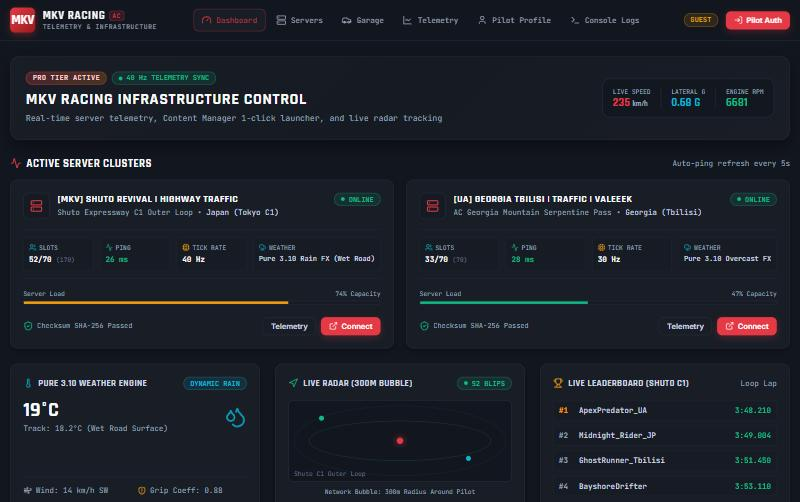
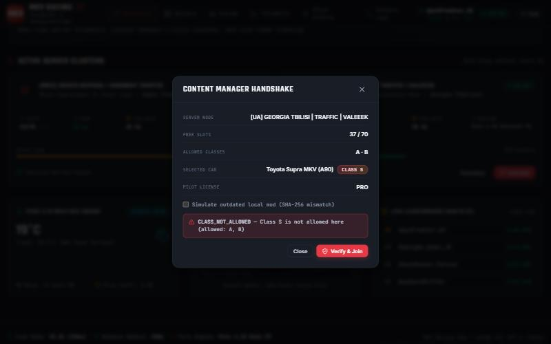
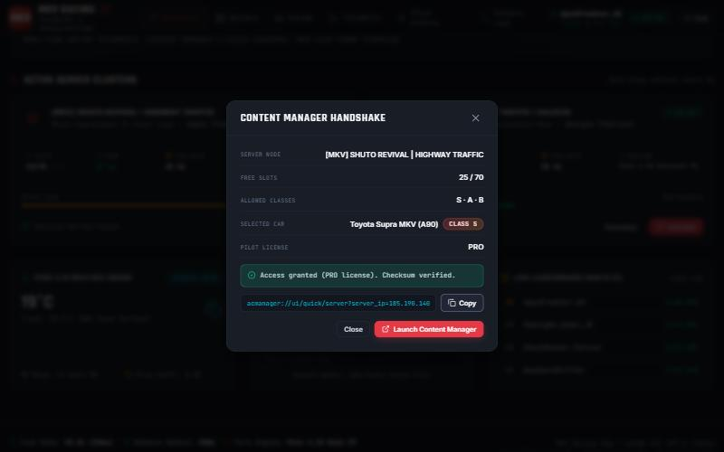
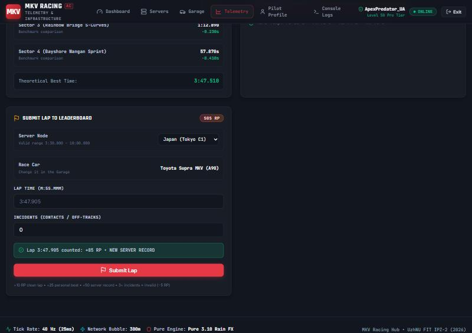
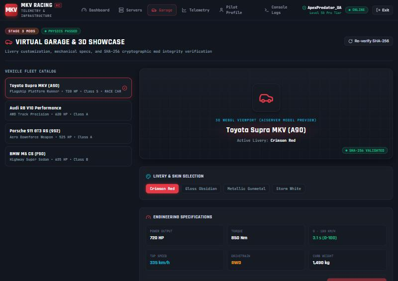
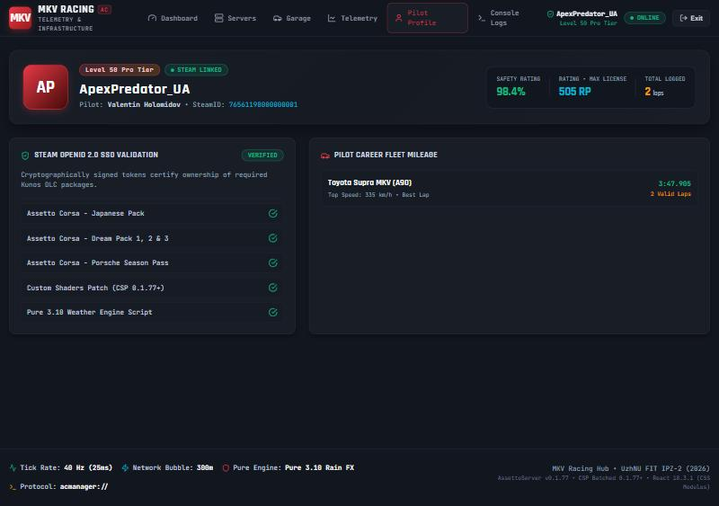
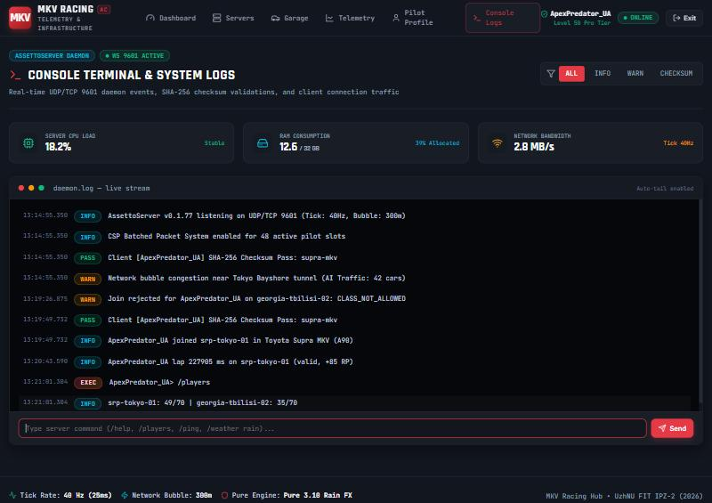

# МІНІСТЕРСТВО ОСВІТИ І НАУКИ УКРАЇНИ

## ДЕРЖАВНИЙ ВИЩИЙ НАВЧАЛЬНИЙ ЗАКЛАД «УЖГОРОДСЬКИЙ НАЦІОНАЛЬНИЙ УНІВЕРСИТЕТ»

### ФАКУЛЬТЕТ ІНФОРМАЦІЙНИХ ТЕХНОЛОГІЙ

### КАФЕДРА ПРОГРАМНОГО ЗАБЕЗПЕЧЕННЯ СИСТЕМ

<br><br>

# Лабораторна робота №6

## з дисципліни «Розробка веб-застосунків на базі React»

### на тему: «Реалізація бізнес-логіки та користувацьких хуків для обміну даними з сервером і авторизації у веб-застосунку «MKV Racing»»

<br><br><br>

**Виконав:**  
Студент 1-го курсу  
Факультету інформаційних технологій  
Денної форми навчання  
Групи ІПЗ – 2  
**Голомідов Валентин Миколайович**

**Перевірив:**  
викладач **Бучук Р. В.**

<br><br>

**Ужгород 2026**

---

## ВСТУП ТА МЕТА РОБОТИ

**Мета роботи:** Реалізувати бізнес-логіку веб-застосунку «MKV Racing» (платформа серверів автосимулятора Assetto Corsa), винести її на REST API, створити користувацькі React-хуки для отримання (GET) та надсилання (POST) даних на сервер, а також хук авторизації пілотів з використанням бібліотеки **axios**. Підключити хуки до існуючих сторінок без зміни дизайну, розробленого в лабораторних роботах №3–5, та оформити зміни у вигляді Pull Request.

**Завдання:**

1. Реалізувати бізнес-логіку проєкту.
2. Створити користувацькі хуки для отримання (fetch/post) даних із/на сервер та для авторизації, використовуючи fetch або axios (обрано axios).
3. Можливе використання бібліотеки TanStack Query — за бажанням (див. п. 3.5).
4. Створити Pull Request.
5. Оформити звіт.

---

## РОЗДІЛ 1. АРХІТЕКТУРА РІШЕННЯ

До лабораторної №6 усі дані застосунку (сервери, автопарк, лідерборд, логи, профіль пілота) були захардкоджені в Zustand-store та компонентах, а авторизація лише імітувалася через `setTimeout`. У цій роботі застосунок переведено на клієнт-серверну архітектуру:

```text
React-сторінки (дизайн Лаб. 4–5 без змін)
        │  викликають
        ▼
Доменні хуки  src/hooks/useRacing.js   (useServers, useJoinServer, useSubmitLap, ...)
        │  побудовані на
        ▼
Базові хуки   useFetch · useMutation · useAuth
        │  використовують
        ▼
axios-інстанс src/services/apiClient.js (Bearer-токен, обробка 401, нормалізація помилок)
        │  HTTP /api/v1  (Vite proxy → :4000)
        ▼
REST API      server/index.js  (Express)  →  бізнес-правила server/logic.js  →  server/db.json
```

| Шар               | Файли                                                   | Відповідальність                                                                                     |
| ----------------- | ------------------------------------------------------- | ---------------------------------------------------------------------------------------------------- |
| REST API          | `server/index.js`                                       | Маршрути, хешування паролів (scrypt), підписані токени (HMAC-SHA256), журнал подій, збереження даних |
| Бізнес-логіка     | `server/logic.js`, `server/data.js`                     | Чисті функції: правила допуску, ліцензії, anti-cheat, рейтинг, лідерборд, консольні команди          |
| HTTP-клієнт       | `src/services/apiClient.js`                             | axios-інстанс з interceptor'ами, `normalizeError`, запуск `acmanager://`                             |
| Базові хуки       | `src/hooks/useFetch.js`, `useMutation.js`, `useAuth.js` | Універсальні GET / POST та авторизація                                                               |
| Доменні хуки      | `src/hooks/useRacing.js`                                | Хуки предметної області для сторінок                                                                 |
| Клієнтська логіка | `src/utils/racing.js`                                   | Формат/парсинг часу кола, наступна ліцензія, причина блокування авто                                 |
| UI                | `src/features/**`, `Alert`, `JoinServerModal`           | Існуючі сторінки + повідомлення про помилки та вікно підключення                                     |

Глобальний Zustand-store залишився, але тепер зберігає лише сесію пілота та стан інтерфейсу (відкрите вікно входу, вибрана лівреа, симуляція телеметрії). Усі доменні дані надходять з API.

### 1.1. REST API

| Метод      | Маршрут                                | Авторизація | Опис                                                                   |
| ---------- | -------------------------------------- | ----------- | ---------------------------------------------------------------------- |
| POST       | `/auth/register`                       | —           | Реєстрація пілота (валідація email, позивного, пароля, SteamID64)      |
| POST       | `/auth/login`                          | —           | Вхід за email або позивним                                             |
| POST       | `/auth/steam`                          | —           | Steam OpenID 2.0 (у навчальному середовищі — за прив'язаним SteamID64) |
| GET        | `/auth/me`                             | ✔           | Поточний пілот за токеном                                              |
| GET        | `/servers`, `/servers/:id`             | —           | Сервери з live-станом (онлайн, пінг, вільні слоти)                     |
| GET        | `/cars`                                | —           | Автопарк з класами та SHA-256                                          |
| POST       | `/cars/:id/verify`                     | —           | Перевірка контрольної суми файлів авто                                 |
| POST       | `/garage/select`                       | ✔           | Вибір авто для заїздів (перевірка ліцензії)                            |
| POST       | `/servers/:id/join`                    | ✔           | Перевірка допуску та створення ігрової сесії                           |
| GET / POST | `/sessions/current`, `/sessions/leave` | ✔           | Поточна сесія, вихід із сервера                                        |
| POST       | `/laps`                                | ✔           | Зарахування кола, нарахування рейтингу                                 |
| GET        | `/leaderboard/:serverId`               | —           | Таблиця лідерів                                                        |
| GET        | `/me/stats`                            | ✔           | Статистика пілота                                                      |
| GET / POST | `/logs`, `/logs/command`               | — / ✔       | Журнал подій сервера, консольні команди                                |

---

## РОЗДІЛ 2. БІЗНЕС-ЛОГІКА ПРОЄКТУ

### 2.1. Авторизація пілотів

Пароль зберігається тільки у вигляді хешу **scrypt** з випадковою сіллю; порівняння виконується через `timingSafeEqual`. Після входу сервер видає токен формату `base64url(payload).HMAC-SHA256` з терміном дії 24 години. Правила реєстрації: коректний email, позивний 3–20 символів (латиниця, цифри, `_`), пароль ≥ 6 символів з літерами та цифрами, SteamID64 — 17 цифр, що починаються з `7656`. Помилки валідації повертаються по полях і підсвічуються у формі.

### 2.2. Ліцензії, рівень та індекс безпеки

| Ліцензія | Рейтинг (RP) | Доступні класи авто              |
| -------- | ------------ | -------------------------------- |
| ROOKIE   | 0–99         | B (BMW M5 CS)                    |
| CLUB     | 100–299      | A, B (+ Audi R8, Porsche GT3 RS) |
| PRO      | 300+         | S, A, B (+ Toyota Supra MKV)     |

Рівень пілота обчислюється як `рейтинг / 10` і формує підпис «Level 42 Pro Tier» у навігації. Індекс безпеки = 100% − 0,4% за кожен інцидент (контакт / виліт).

### 2.3. Допуск на сервер (Content Manager handshake)

Перед видачею посилання `acmanager://` сервер послідовно перевіряє п'ять правил:

| Код помилки               | Правило                                                         |
| ------------------------- | --------------------------------------------------------------- |
| `SERVER_OFFLINE` (409)    | Сервер online, а не на обслуговуванні                           |
| `SERVER_FULL` (409)       | Є вільні слоти                                                  |
| `CLASS_NOT_ALLOWED` (422) | Клас авто дозволений на сервері (Shuto: S/A/B, Georgia: A/B)    |
| `LICENSE_TOO_LOW` (403)   | Ліцензія пілота відкриває цей клас                              |
| `CHECKSUM_MISMATCH` (422) | SHA-256 локальних файлів авто збігається з серверним маніфестом |

```js
export function checkJoin({ server, car, user, clientChecksum }) {
  if (!server) throw new DomainError(404, 'SERVER_NOT_FOUND', 'Server node not found');
  if (!car) throw new DomainError(404, 'CAR_NOT_FOUND', 'Select a car in the Garage first');
  if (server.status !== 'online') throw new DomainError(409, 'SERVER_OFFLINE', '...');
  if (server.freeSlots <= 0) throw new DomainError(409, 'SERVER_FULL', '...');
  if (!server.allowedClasses.includes(car.carClass))
    throw new DomainError(422, 'CLASS_NOT_ALLOWED', '...');
  const license = licenseFor(user.rating);
  if (!license.classes.includes(car.carClass)) throw new DomainError(403, 'LICENSE_TOO_LOW', '...');
  if (clientChecksum !== car.sha256) throw new DomainError(422, 'CHECKSUM_MISMATCH', '...');
  return { joinUrl: buildJoinUrl(server, car.id), license: license.code };
}
```

_Лістинг 2.1 — Перевірка допуску на сервер (`server/logic.js`)_

Пілот може бути лише в одній активній сесії: нове підключення закриває попередню. Кількість онлайн-гравців на сервері враховує активні сесії. Кожна спроба (успішна чи відхилена) записується в журнал подій.

### 2.4. Зарахування кіл, anti-cheat та рейтинг

- Для кожної траси задано допустимий діапазон часу кола (Shuto C1: 3:30–10:00, Georgia: 2:00–8:00). Нереалістично швидке коло відхиляється з кодом `LAP_TOO_FAST`.
- Коло з більш ніж 2 інцидентами зберігається, але вважається **невалідним** (як invalid lap в Assetto Corsa): не потрапляє в лідерборд і знімає 5 RP.
- Нарахування за валідне коло: **+10 RP**, особистий рекорд **+25 RP**, рекорд сервера **+50 RP**.
- Лідерборд будується з найкращого валідного кола кожного пілота і показує відставання від лідера.

### 2.5. Гараж і консоль

- Обрати авто для заїздів можна лише з класів, доступних за ліцензією (`LICENSE_TOO_LOW`).
- Кнопка «Re-verify SHA-256» звіряє контрольну суму з сервером, результат записується в журнал.
- Консоль підтримує команди `/help`, `/players`, `/ping`, `/weather <rain|clear|overcast>`; `/weather` доступна лише з ліцензією PRO, невідомі команди повертають попередження.

---

## РОЗДІЛ 3. КОРИСТУВАЦЬКІ ХУКИ

### 3.1. HTTP-клієнт на axios

```js
export const http = axios.create({ baseURL: '/api/v1', timeout: 10_000 });

http.interceptors.request.use((config) => {
  const token = localStorage.getItem(TOKEN_KEY);
  if (token) config.headers.Authorization = `Bearer ${token}`;
  return config;
});

http.interceptors.response.use(
  (response) => response,
  (error) => {
    if (error.response?.status === 401 && localStorage.getItem(TOKEN_KEY)) {
      localStorage.removeItem(TOKEN_KEY);
      window.dispatchEvent(new Event('mkv:unauthorized'));
    }
    return Promise.reject(error);
  }
);
```

_Лістинг 3.1 — axios-інстанс з interceptor'ами (`src/services/apiClient.js`)_

Функція `normalizeError` приводить будь-яку помилку до вигляду `{ status, code, message, fields }`, тому всі сторінки показують помилки однаково (компонент `Alert`).

### 3.2. `useFetch` — отримання даних

Повертає `data`, `error`, `loading`, `refetch`, `setData`. Особливості:

- попередній запит скасовується через `AbortController` — відповідь на застарілі параметри не перезапише нові дані;
- `pollInterval` вмикає періодичне оновлення (сервери — 5 с, лідерборд — 10 с, логи — 3 с); фонові оновлення не вмикають індикатор завантаження;
- `url = null` — умовне завантаження (наприклад, статистика лише для авторизованого пілота).

```js
export function useFetch(url, { params, pollInterval, initialData = null } = {}) {
  const [data, setData] = useState(initialData);
  const [error, setError] = useState(null);
  const [loading, setLoading] = useState(Boolean(url));
  const controllerRef = useRef(null);
  const paramsKey = JSON.stringify(params ?? {});

  const load = useCallback(
    async ({ silent = false } = {}) => {
      if (!url) return;
      controllerRef.current?.abort();
      const controller = new AbortController();
      controllerRef.current = controller;
      if (!silent) setLoading(true);
      try {
        const res = await http.get(url, {
          params: JSON.parse(paramsKey),
          signal: controller.signal,
        });
        setData(res.data);
        setError(null);
      } catch (e) {
        const err = normalizeError(e);
        if (err) setError(err);
      } finally {
        if (controllerRef.current === controller) setLoading(false);
      }
    },
    [url, paramsKey]
  );

  useEffect(() => {
    load();
    const id = pollInterval && url ? setInterval(() => load({ silent: true }), pollInterval) : null;
    return () => {
      if (id) clearInterval(id);
      controllerRef.current?.abort();
    };
  }, [load, pollInterval, url]);

  return { data, error, loading, refetch: load, setData };
}
```

_Лістинг 3.2 — Хук `useFetch` (`src/hooks/useFetch.js`)_

### 3.3. `useMutation` — надсилання даних

`mutate(vars)` виконує POST/PUT/DELETE, повертає `Promise` і зберігає результат у стані хука (`data`, `error`, `loading`). Підтримуються колбеки `onSuccess` / `onError` та динамічна адреса — наприклад, `({ serverId }) => \`/servers/${serverId}/join\``. Прапорець `mounted`захищає від оновлення стану розмонтованого компонента (з урахуванням подвійного монтування в`React.StrictMode`).

### 3.4. `useAuth` — авторизація

- `useAuthBootstrap()` викликається один раз в `App`: відновлює сесію за збереженим токеном (`GET /auth/me`) і виконує вихід, коли interceptor повідомляє про 401.
- `useAuth()` повертає `user`, `isAuthenticated`, `signIn(login, password)`, `signInWithSteam()`, `register(form)`, `signOut()`, `requireAuth()`, `updateUser()`.
- `requireAuth()` використовується для дій, що потребують входу (Connect, вибір авто, зарахування кола, консольні команди): гостю відкривається існуюче вікно `AuthModal`.

### 3.5. Доменні хуки та TanStack Query

| Хук                              | Що робить                                       | Де використовується               |
| -------------------------------- | ----------------------------------------------- | --------------------------------- |
| `useServers()` / `useServer(id)` | Сервери з live-станом, оновлення кожні 5 с      | Dashboard, Servers, Server Detail |
| `useCars()`                      | Автопарк + словник `byId`                       | Garage, Statistics, Join          |
| `useSelectCar()`                 | Вибір авто для заїздів, оновлює пілота у store  | Garage                            |
| `useVerifyChecksum()`            | Перевірка SHA-256                               | Garage                            |
| `useJoinServer()`                | Перевірка допуску та підключення                | JoinServerModal                   |
| `useLeaderboard(id)`             | Лідерборд, оновлення кожні 10 с                 | Dashboard                         |
| `useSubmitLap()`                 | Відправка кола, новий рейтинг одразу у store    | Statistics                        |
| `useMyStats()`                   | Статистика пілота                               | Statistics, Profile               |
| `useServerLogs(level)`           | Журнал з фільтром на сервері + відправка команд | Console Logs                      |

Бібліотеку **TanStack Query** свідомо не використано: власні хуки `useFetch` / `useMutation` наочно показують механізми станів завантаження, скасування запитів і polling. Інтерфейс хуків (`data / error / loading`, `mutate`) зроблено подібним до TanStack Query, тож перехід на неї не потребуватиме змін у сторінках.

---

## РОЗДІЛ 4. РЕЗУЛЬТАТИ РОБОТИ ІНТЕРФЕЙСУ

Дизайн сторінок (CSS Modules, Dark Racing UI) залишено без змін — змінилося лише джерело даних.


_Рис. 4.1 — Dashboard: онлайн, пінг і лідерборд надходять з API_


_Рис. 4.2 — Відмова в допуску: Supra (клас S) не допускається на Georgia (A, B)_


_Рис. 4.3 — Успішна перевірка допуску та посилання для Content Manager_


_Рис. 4.4 — Зарахування кола 3:47.905: рекорд сервера, +85 RP, рівень у навігації оновився_


_Рис. 4.5 — Гараж: класи авто та позначка RACE CAR_


_Рис. 4.6 — Профіль: рейтинг, ліцензія, кола та найкращий час з API_


_Рис. 4.7 — Консоль: події допуску, кіл і результат команди `/players`_

---

## РОЗДІЛ 5. ТЕСТУВАННЯ

1. **Тести бізнес-логіки** (`npm run test:api`, вбудований `node:test`): 7 тестів, **7 пройдено, 0 помилок** — валідація реєстрації, ліцензії/рівень/безпека, успішний допуск і всі п'ять відмов, anti-cheat та інциденти, рейтинг і лідерборд (невалідні кола не враховуються), права на консольні команди.
2. **ESLint** (`npm run lint`): 0 помилок, 0 попереджень. Код відформатовано Prettier.
3. **Збірка Vite** (`npm run build`): успішно.
4. **Cypress**: компонентні тести `AuthModal` оновлено — запити до API підміняються через `cy.intercept`, додано тест на показ помилки 401; E2E-тест авторизації використовує демо-акаунт із seed-даних.
5. **Ручне тестування в браузері**: вхід через «Use Demo Credentials» і Steam; Connect для гостя відкриває вікно входу; відмова `CLASS_NOT_ALLOWED` на Georgia; успішне підключення до Shuto; коло 1:05.000 відхилено anti-cheat; коло 3:47.905 зараховано як рекорд сервера (+85 RP); команда `/players` у консолі.

---

## РОЗДІЛ 6. PULL REQUEST

Робота виконана в гілці `feature/business-logic-hooks`, відгалуженій від `feature/routing-navigation` (результат лабораторної №5). Зміни зафіксовано атомарними комітами та оформлено Pull Request:

**PR:** [#5 — Лабораторна робота №6: Бізнес-логіка та користувацькі хуки](https://github.com/ValentinHol0/mkv-racing-web/pull/5) (`feature/business-logic-hooks` → `feature/routing-navigation`)

---

## ВИСНОВКИ

1. Бізнес-логіку платформи «MKV Racing» винесено на REST API (Express): авторизація з хешуванням паролів і підписаними токенами, система ліцензій, п'ятиступенева перевірка допуску на сервер (включно з SHA-256 модів), anti-cheat перевірка кіл з урахуванням інцидентів, рейтинг, лідерборд і журнал подій.
2. Створено користувацькі хуки на axios: `useFetch` (скасування запитів, polling, умовне завантаження), `useMutation` (POST/PUT/DELETE з колбеками) та `useAuth` (вхід, Steam, реєстрація, вихід, відновлення сесії, автологаут на 401), а також 10 доменних хуків.
3. Хуки підключено до всіх сторінок без зміни дизайну з лабораторних №4–5; захардкоджені дані у store замінено даними з сервера.
4. Бізнес-логіку покрито автоматичними тестами, оновлено Cypress-тести; лінтер і збірка проходять без помилок.
5. Зміни оформлено у вигляді Pull Request на GitHub.

---

## СПИСОК ВИКОРИСТАНИХ ДЖЕРЕЛ

1. Офіційна документація React: Reusing Logic with Custom Hooks. Режим доступу: https://react.dev/learn/reusing-logic-with-custom-hooks
2. Документація axios: Interceptors. Режим доступу: https://axios-http.com/docs/interceptors
3. MDN Web Docs: AbortController. Режим доступу: https://developer.mozilla.org/en-US/docs/Web/API/AbortController
4. Документація Express 4. Режим доступу: https://expressjs.com/
5. Node.js: Test runner (`node:test`). Режим доступу: https://nodejs.org/api/test.html
6. TanStack Query: Overview. Режим доступу: https://tanstack.com/query/latest
